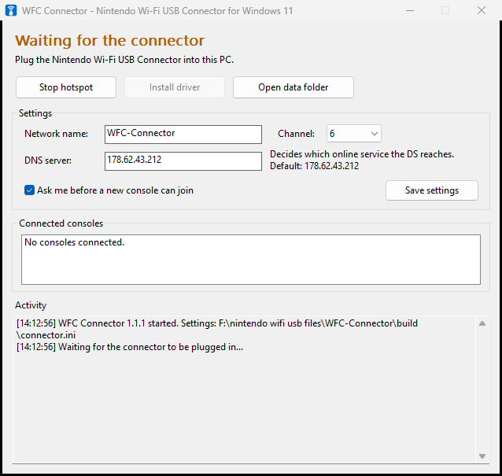

# Nintendo Wi-Fi USB Connector for Windows 10/11

## How to use

1. Download **WFCConnector-v1.1.1-win64.zip** from [Releases](../../releases) and unzip it.
2. Plug the connector straight into your PC, not into a USB hub.
3. Run `WFCConnector.exe`. If it says **Driver needed**, click **Install driver** and allow the prompt. You only do this once.
4. On the DS: **Nintendo WFC Settings** > **Connection Settings** > an empty slot > **Search for an Access Point** > **WFC-Connector**.
5. Click **Yes** when the program asks to allow your console.

Keep the window open while you play. If Windows Firewall asks about the program, click **Allow**.

> Don't use the DS's "Nintendo Wi-Fi USB Connector" option. It only works with Nintendo's old software.

## About

Nintendo's own software only runs on 32-bit Windows XP and Vista. This replaces it with one program that uses Microsoft's built-in WinUSB driver, so nothing unsigned gets installed.

- **DNS:** sets which online service consoles reach. Change it in the window, and it takes effect right away.
- **Logs:** written to `connector-log.txt`. Click **Open data folder** to find it.

Some online features depend on the service your DNS points to. For example, the Pokémon Platinum Wi-Fi Plaza doesn't work on the default DNS.

## Building

You need MinGW-w64. Run `make` to build, and `make test` to build the self-test. Technical details are in [docs/HOW-IT-WORKS.md](docs/HOW-IT-WORKS.md).

## License

GNU GPL v2 or later. The chip setup is based on the Linux `rt2500usb` driver. Not affiliated with Nintendo.
